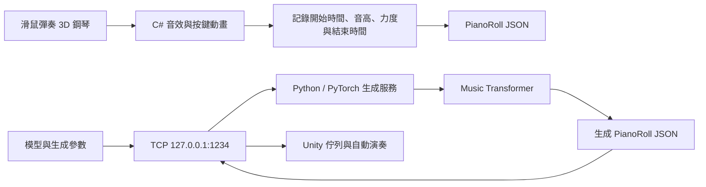

# Unity AI Piano Composer

> 2022–2023 大學團隊專題｜Unity 互動式鋼琴 × PyTorch Music Transformer

這個專題把可彈奏的 3D 鋼琴、音符事件資料、Python 音樂生成模型與本機 Socket 通訊整合成一條完整流程。使用者可在 Unity 介面操作鋼琴與生成參數；Python 服務產生 piano-roll JSON 後，Unity 會解析音高、時間與力度並在虛擬鍵盤上自動演奏。

這是大學期間的專題原始碼封存，重點是呈現當時完成的跨語言系統整合與生成模型實驗，不代表目前可一鍵部署的正式產品。

## 系統流程

彈奏記錄與生成服務是兩條獨立能力：目前封存版本的模型以起始 token 生成新片段，並未把使用者剛彈奏的片段當成續寫 prompt。

## 已實作內容

### Unity 互動端

- 以多個音域的 3D 琴鍵、Box Collider 與本機音源建立可點擊鋼琴。
- 按下琴鍵時播放對應音檔、顯示音名、改變琴鍵位置並記錄起訖時間。
- 將事件整理為 `start time / pitch / velocity / end time` 的 piano-roll JSON 格式。
- 接收 Python 回傳的生成結果，依時間軸觸發琴鍵、音量、動畫與音效。
- 提供 Oriental／Pop 模型切換，以及 `temperature`、`p`、最小生成長度等介面參數。

### Python 音樂生成端

- 以 PyTorch 實作 Music Transformer 類型的 decoder 模型與相對位置 attention。
- 將 piano-roll 事件轉為 `bar`、`starttime`、`level`、`power`、`endtime` token。
- 前處理流程包含 pitch shift、time stretch、padding 與 tensor 輸出。
- 訓練器包含 80/20 train-validation split、Adam、Transformer learning-rate schedule 與 checkpoint 儲存。
- 生成端可載入兩組模型名稱，將輸出 token 還原成 piano-roll JSON。

原始超參數設定為 `d_model=128`、3 層 decoder、8 個 attention heads、`d_ff=512` 與 dropout 0.1。

### Unity 與 Python 整合

- C# 與 Python 以 `127.0.0.1:1234` 的 TCP Socket 溝通。
- 訊息採「4-byte 長度前綴＋UTF-8 JSON」格式，避免只靠封包邊界判斷完整訊息。
- Unity 傳送模型與生成參數；Python 回傳生成事件；Unity 將結果加入播放佇列。

## 團隊與個人貢獻

這是兩人團隊專題，Git 歷史保留兩位貢獻者：[@steven65026502](https://github.com/steven65026502) 與 [@Jimmy01240397](https://github.com/Jimmy01240397)。以下分工依 repository 的 commit 歷史整理：

- **@steven65026502**：piano-roll 資料字典與前處理、Music Transformer 訓練／生成程式、後期 Unity–Python Socket 整合、生成參數與模型切換 UI、最終場景整合。
- **@Jimmy01240397**：早期 Unity JSON 流程、Python 伺服器傳送、琴鍵回放與音效行為修正，以及初期目錄整理。

## 專案結構

| 路徑 | 內容 |
| --- | --- |
| `Piano/` | Unity 2022.1.15f1 專案。 |
| `Piano/Assets/PIANO.unity` | 主要整合場景。 |
| `Piano/Assets/Script/` | 琴鍵互動、事件記錄、播放佇列、Socket 與生成控制介面。 |
| `PianoServer/` | Python 資料處理、Music Transformer、訓練、生成與 TCP 服務。 |
| `pianoroll/` | 專題使用的處理後 piano-roll JSON 資料。 |

## 閱讀入口

- Unity Socket 與播放流程：[`Piano/Assets/Script/Tools/Manager.cs`](Piano/Assets/Script/Tools/Manager.cs)
- 琴鍵互動與事件記錄：[`Piano/Assets/Script/Script_Note.cs`](Piano/Assets/Script/Script_Note.cs)
- 生成控制介面：[`Piano/Assets/Script/Teleporatation.cs`](Piano/Assets/Script/Teleporatation.cs)
- 模型結構：[`PianoServer/model.py`](PianoServer/model.py)
- 訓練流程：[`PianoServer/training.py`](PianoServer/training.py)
- 生成與 TCP 服務：[`PianoServer/generate_test.py`](PianoServer/generate_test.py)

## 封存狀態與限制

2026-08-25 重新盤點 repository 時，13 個 Python 檔案均可通過語法樹解析；但目前環境沒有原專案指定的 Unity Editor，因此未重新執行 Unity 場景或端到端生成流程。

要重現完整生成流程，仍需補齊下列項目：

- 原始模型權重 `final_model.pt` 與 `pop_music.pt` 未包含在 repository。
- Python 套件版本未鎖定，原始碼主要依賴 PyTorch 與 NumPy。
- 訓練、前處理與評估腳本保留舊電腦的絕對路徑，執行前必須改成自己的資料路徑。
- 部分中途實驗腳本可能與最後的 Music Transformer 類別名稱不一致。
- 生成取樣參數與 Socket 例外流程沒有自動化測試，重新使用前應先補回歸測試。
- 處理後資料、音源與部分素材的原始授權資訊未在當年的 repository 中完整記錄，因此此 repo 僅作專題與程式碼審閱，不應直接視為可再散布的素材包。

## 這個專題展現的能力

- 把 Unity/C#、Python/PyTorch、TCP Socket 與 JSON 資料契約串成跨語言系統。
- 將音樂事件轉成可訓練、可生成、也可回放的結構化資料。
- 從模型訓練延伸到互動介面與即時播放，而不只停留在單一 notebook 實驗。
- 能回頭辨識舊專案在環境重現、模型交付、測試與素材授權上的不足。
